---
## Author
author:
  name: Чаплыгин Александр Сергеевич
  degrees: DSc
  email: 1032261466@rudn.ru
  affiliation:
    - name: Российский университет дружбы народов
      country: Российская Федерация
      postal-code: 117198
      city: Москва
      address: ул. Миклухо-Маклая, д. 6

## Title
title: "Отчёт по лабораторной работе №2"
subtitle: "дисциплина: Архитектура компьютера"
license: "CC BY"
---

# Цель работы
Изучение идеологии и применения средств контроля версий, приобретение
практических навыков по работе с системой контроля версий Git.

#Выполнение лабораторной работы
1. Для работы с удалённым репозиторием использована учётная запись на GitHub.
После входа открыли главную страницу сервиса, с которой можно перейти к
созданию репозитория и дальнейшей работе с файлами курса.
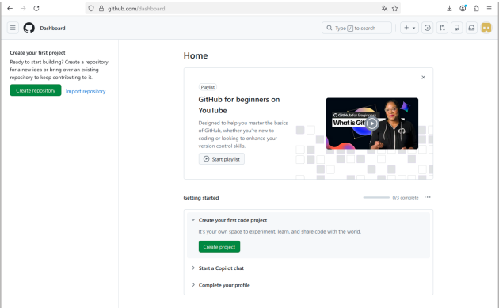
2. В терминале выполнили предварительную настройку Git: указали имя
владельца репозитория и адрес электронной почты. Для параметра user.name задано
значение «Alexander Chaplyghin», а для user.email — «1032261466@rudn.ru». 
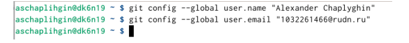
3. Выполнили настройку вывода Git. Командой git config --global core.quotepath
false параметру core.quotepath присвоили значение false. 
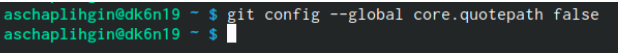
4. Выполнили настройку параметра init.defaultBranch, который задаёт имя
начальной ветки.
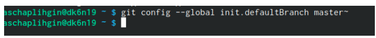
5. Продолжили базовую настройку Git и задали два параметра. Для core.autocrlf
установили значение input, а для core.safecrlf — значение warn. 
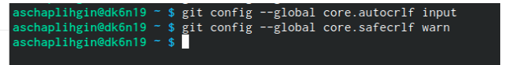
6. Для идентификации пользователя на сервере репозиториев создали пару SSHключей: закрытый и открытый. Выполнили команду ssh-keygen -t ed25519 -C с
адресом электронной почты, после чего ключи были сохранены в каталоге .ssh. В
конце вывели содержимое файла id_ed25519.pub командой cat; этот открытый ключ
используется для добавления на сервер.
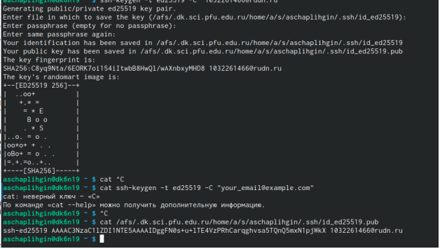
7. Добавили созданный открытый ключ в настройки учётной записи GitHub. В
разделе SSH keys появился ключ с названием «б»; Наличие записи в списке
подтверждает добавление ключа в учётную запись.
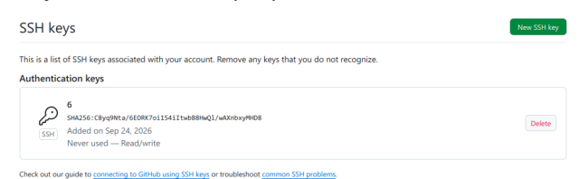
8. Через веб-интерфейс GitHub создали репозиторий study_2026-2027_arh-pc.
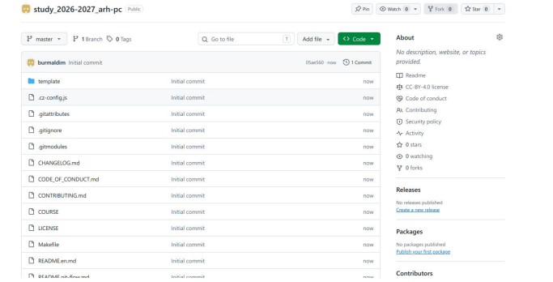
9. Выполнили команду git clone с SSH-адресом созданного репозитория GitHub.
При первом подключении подтвердили доверие к серверу, после чего Git получил
объекты репозитория. 
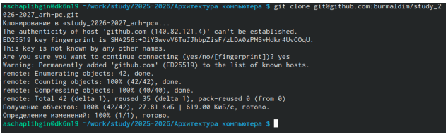
10. После создания коммита выполнили git push. В терминале отображается
отправка объектов на GitHub и обновление удалённой ветки master. Вывод команды
на рис. 14 подтверждает завершение передачи изменений в удалённый репозиторий.
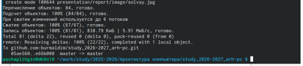
11. Открыли каталог labs на странице удалённого репозитория и проверили
наличие каталогов лабораторных работ. На рис. 15 отображаются lab01–lab11 и файлы
README. Названия каталогов соответствуют указанному в методичке виду
lab<номер>; создание локальных файлов в этой структуре также отражено в выводе
коммита на рис. 13.
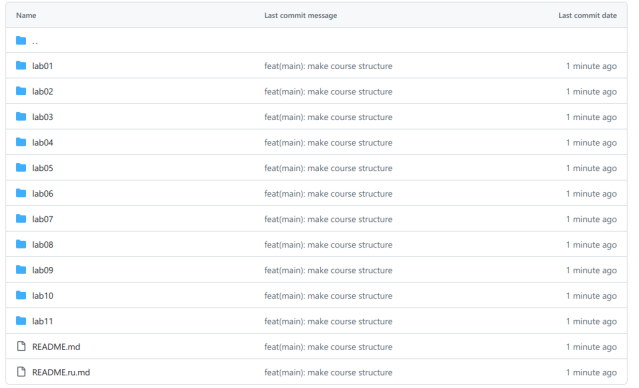
# Самостоятельная работа

1. Подготовили каталог labs/lab02/report для размещения отчёта по лабораторной
работе № 2. Для этого из корня локального репозитория выполнили команду mkdir -p
labs/lab02/report. 
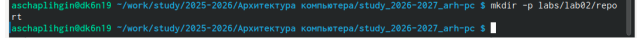
2. Разместили PDF-отчёт по лабораторной работе № 1 в каталоге labs/lab01/report.
Затем добавили файлы командой git add ., создали коммит с сообщением «add files» и
выполнили git push.
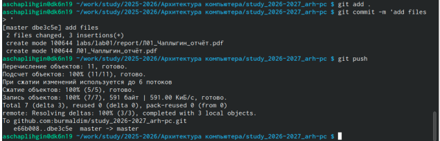

# Выводы

В ходе работы изучены назначение и применение системы контроля версий Git.
Получены практические навыки настройки параметров Git, создания пары SSHключей, клонирования репозитория и подготовки структуры каталогов курса.
Выполнены добавление файлов, фиксация изменений в коммитах и их отправка в
удалённый репозиторий.

