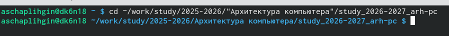
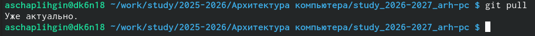
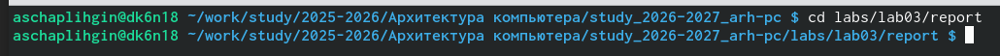
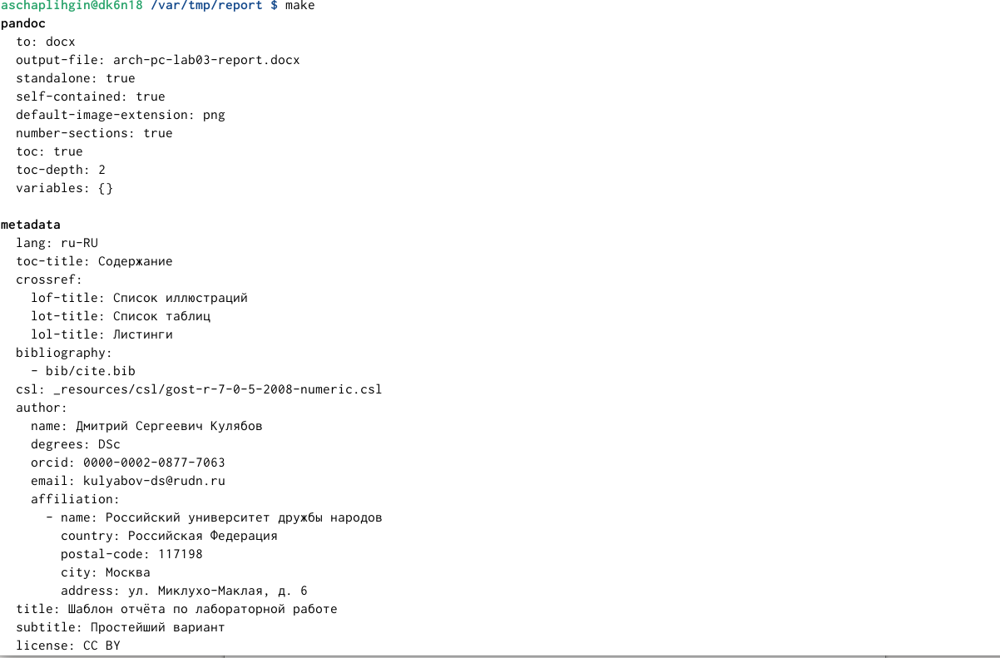
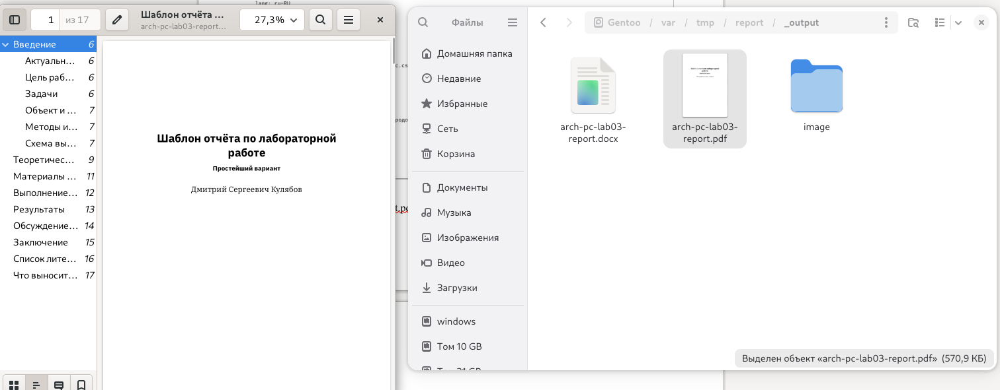
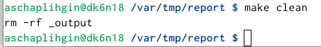
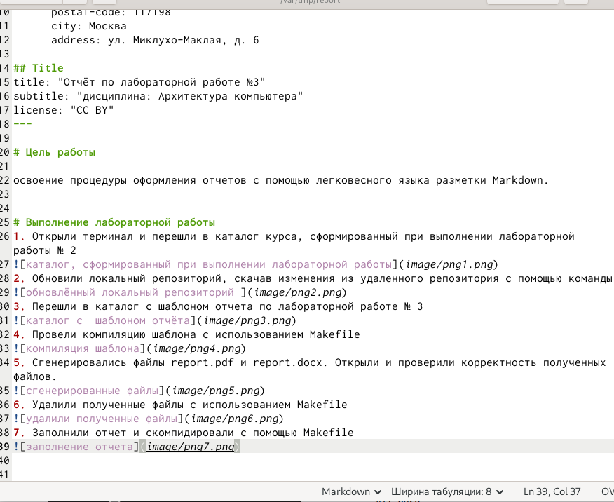
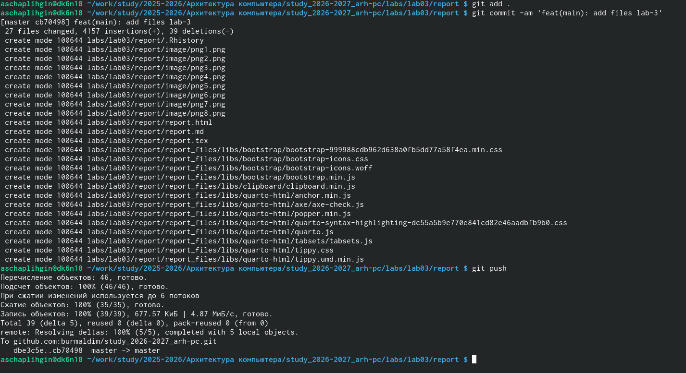
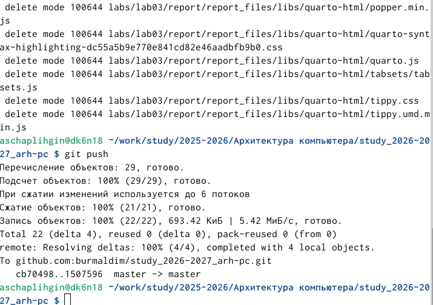

---
## Author
author:
  name: Чаплыгин Александр Сергеевич
  degrees: DSc
  email: 1032261466@rudn.ru
  affiliation:
    - name: Российский университет дружбы народов
      country: Российская Федерация
      postal-code: 117198
      city: Москва
      address: ул. Миклухо-Маклая, д. 6

## Title
title: "Отчёт по лабораторной работе №3"
subtitle: "дисциплина: Архитектура компьютера"
license: "CC BY"
---

# Цель работы

освоение процедуры оформления отчетов с помощью легковесного языка разметки Markdown.

# Выполнение лабораторной работы
1. Открыли терминал и перешли в каталог курса, сформированный при выполнении лабораторной работы № 2

2. Обновили локальный репозиторий, скачав изменения из удаленного репозитория с помощью команды

3. Перешли в каталог с шаблоном отчета по лабораторной работе № 3

4. Провели компиляцию шаблона с использованием Makefile

5. Сгенерировались файлы report.pdf и report.docx. Открыли и проверили корректность полученных файлов.

6. Удалили полученные файлы с использованием Makefile

7. Открыли файл с помощью gedit

8. Заполнили отчет и скомпилировали с помощью Makefile

9. Загрузите файлы на Github.

# Задание для самостоятельной работы
1. В соответствующем каталоге сделали отчёт по лабораторной работе 2 и загрузили на github

# Вывод
Освоили процедуры оформления отчетов с помощью легковесного языка разметки Markdown.

